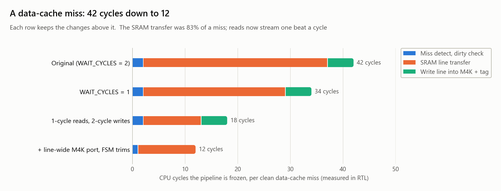
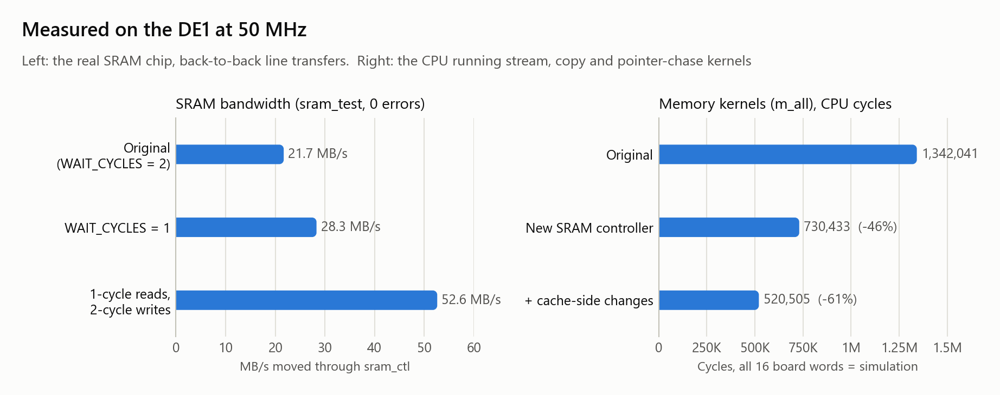
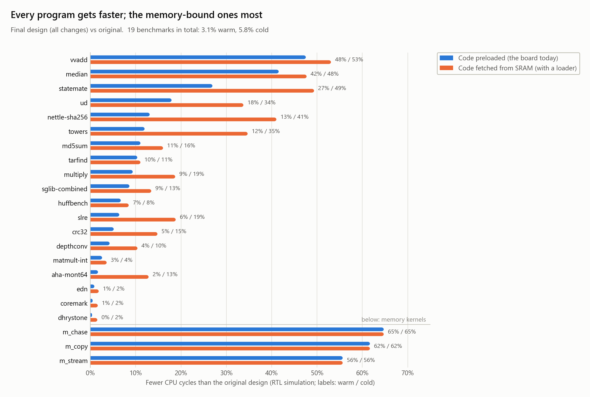

# Memory system optimizations

The pipeline froze for **42 cycles on every data-cache miss**, and 35 of those were the SRAM
controller moving the line. This study speeds up that path in five steps, measures each in
RTL simulation, and checks the result on the DE1. A clean miss now costs **12 cycles**, the
SRAM moves **2.4× more data per second on the real chip**, and memory-bound code runs
**up to 2.8× faster**. Every program still computes exactly what it did before.



| Design (each keeps the changes above it) | Clean miss | Dirty miss | 19 benchmarks, warm | cold | Memory kernels (`m_all`) |
|---|---|---|---|---|---|
| Original (`WAIT_CYCLES = 2`) | 42 | 82 | — | — | — |
| `WAIT_CYCLES = 1` | 34 | 66 | −0.8% | −1.7% | −16.5% |
| Pipelined reads (1 cycle a beat) | 18 | 58 | −2.5% | −5.2% | −36.2% |
| + 2-cycle writes (`WE_N` on the falling edge) | 18 | 41 | −2.5% | −5.2% | **−45.6%** (board) |
| + line-wide M4K port, FSM trims | 12 | 31 | −3.1% | −5.8% | −56.8% |
| + write-back buffer | 12 | 29 | −3.1% | −5.8% | **−61.2%** (board) |

- **Miss costs** are CPU cycles the pipeline is frozen. A dirty miss evicts a modified line,
  which has to be written back; its cost is measured on `m_copy`, where half the misses are
  dirty.
- **Warm** is the board today: the program is preloaded into the I-cache. **Cold** fetches
  code from SRAM, as it would with a program loader.
- **(board):** the DE1 measured exactly these cycle counts.

## 1. Where the time went

Measured on the original design with `harness/tb_mem.v`, a twin of the board's counters
(`data/sim/base_*.json`):

- **The data cache froze the pipeline for 4.35% of all cycles** across the 19 benchmarks
  (164,806 of 3,790,660), close to the 5.7% lost to branch flushes. For small programs it
  dominates: vvadd 66%, median 58%, statemate 38%.
- **Every miss cost the same 42 cycles**, and **83% of that (35 cycles) was the SRAM
  transfer**. The controller moves a 16-byte line as 8 beats of 16 bits, and spent 4 cycles
  on each one.
- **All 3,923 misses are compulsory:** the first touch of each line, mostly stores, since
  the cache is write-allocate. There is one write-back in the whole suite. So the lever is
  the cost of a miss, not their number (`model/findings.md` shows that 16 → 32 KB and
  1 → 4 ways change nothing here).
- **With a loader, I-cache misses would cost as much again:** code fetched from SRAM adds
  4,780 I-cache misses at 37 cycles each.
- **Three kernels stress what the suite can't**
  (`model/programs/m_*.S`; `m_all` runs all three back to back):
  - `m_stream` writes a 32 KB array, then reads it back twice;
  - `m_copy` copies between buffers 16 KB apart, so source and destination share every
    cache index;
  - `m_chase` follows pointers over 64 KB.

  With the original design they spend 72%, 92% and 93% of their cycles waiting on memory,
  and their dirty misses cost 82 cycles.

## 2. The changes

### 2.1 `WAIT_CYCLES = 1`: the controller's safety margin (patch: one parameter)

`sram_ctl` gives each beat SETUP, PULSE (`WAIT_CYCLES`) and HOLD. The margin of 2 was
chosen for first bring-up. At 1, a beat takes 3 cycles, a clean miss 34, and the board
passes its full-chip memory test at **28.3 MB/s, up from 21.7**, with 0 errors in 919
rounds. That's a real gain, but it keeps a full cycle of setup and hold around every
read, which a read doesn't need.

### 2.2 Pipelined reads: 1 cycle a beat (`patches/sram_ctl.diff`)

An asynchronous SRAM has no read strobe: with `OE_N` low, its data output simply follows
the address after the 10 ns access time. So reads become a pipeline:

- a new address goes out on every edge;
- the I/O-cell input register samples the previous beat on that same edge;
- the sampled beat is stored one cycle later.

A line read drops from 35 cycles to 11, and a clean miss to **18 cycles**.

**The timing budget, from Quartus** (`data/quartus_sram_pins_*.txt`):

| Path | Slow corner | Fast corner |
|---|---|---|
| Address clock-to-out (I/O register) | 5.72 ns | 3.20 ns |
| Data-in setup / hold at the input register | −1.39 / 1.62 ns | −1.00 / 1.13 ns |

- **Setup:** the address reaches the pins 5.7 ns after the edge, plus 10 ns of SRAM access
  and about 1 ns of board traces. That's roughly 16.7 ns, against 21.4 ns available (20 ns
  plus the 1.4 ns of negative setup): **about 4.7 ns to spare**.
- **Hold:** the next address leaves the FPGA at least 3.2 ns after the edge, and the chip
  keeps driving the old data a little longer after that, against a 1.6 ns requirement.

The read path is still a register from pin to pin, so `RD_CYCLES = 2` is a ready fallback
if a board ever proves marginal: it doubles the budget and costs 8 cycles a miss (26).

### 2.3 Two-cycle writes, `WE_N` from a falling-edge register (same patch, `WR_FAST`)

At whole-cycle granularity a write beat needs at least 3 cycles: the address can't change
on the same edge `WE_N` rises. Driving `WE_N` from a register clocked on the *falling* edge
splits the beat into halves:

- address and data change on a rising edge;
- `WE_N` falls half a cycle later;
- `WE_N` rises half a cycle before the next address.

That gives 10 ns of address setup, a 20 ns pulse and 10 ns of hold, with nothing ever
changing on the same edge as `WE_N`. Quartus packs the falling-edge register into
`WE_N`'s I/O cell, and the pin reports a 5.71 ns clock-to-out from the falling edge.

A line write drops from 35 cycles to 18, and a dirty miss from 58 to **41**. With
pipelined reads, the board's memory test moves **52.6 MB/s with 0 errors in 3,291 rounds**:
about 3.4 billion 16-bit word transfers, with every read checked.



### 2.4 Line-wide M4K port and FSM trims (`patches/c12.diff`)

- **Line-wide port B:** the D-cache's four byte lanes become mixed-width true-dual-port
  M4Ks, 4096×8 on the pipeline's side and 1024×32 on the SRAM's side. A whole line is
  written in one cycle instead of four. This was the TODO in `sram_ctl.v`'s header.
- **Dirty bit read a stage early:** read like the tag, with a bypass for a store hit to the
  same line in flight. That removes `S_CHECK`.
- **Line written on the ack edge:** the line goes straight from the controller into the RAM,
  with its tag, as the transfer completes. That removes `S_FILLWR` and `S_TAG`. The miss
  path becomes IDLE → FILL → DONE.

Together these save 6 cycles per clean miss and 10 per dirty one. That's a fixed amount,
so it's a small share of the original 42 cycles but a third of the 18 left after 2.2.
Still 52 of 52 M4Ks.

### 2.5 Write-back buffer (`patches/c123.diff`)

A dirty victim is parked in the line buffer, the new line is fetched first and the
pipeline goes on, and the write-back runs in the background. Any later miss waits for the
buffer to drain, so a re-fetch can never read stale SRAM. That's safe because the I-cache
reads a different SRAM region.

The suite gains nothing (it has one write-back). On `m_stream`, where there's work between
misses to hide the write-back behind, the gain rises from −48.3% to −55.6%.

## 3. Results



- **The benchmarks:** −3.1% cycles warm and −5.8% cold, all of it from memory stall, which
  falls from 4.35% to 1.28% of cycles warm.
- **Memory-bound programs:**

  | program | warm | cold |
  |---|---|---|
  | vvadd | −48% | −53% |
  | median | −42% | −48% |
  | statemate | −27% | −49% |

  Programs dominated by compute (CoreMark, Dhrystone) gain about 1%.
- **The kernels:** −56% to −65%, so 2.3× to 2.8× faster (`m_all` 2.6×).
- **On the board, at 50 MHz** (`data/board/`):

  | design | `m_all` cycles (all 16 words match simulation) |
  |---|---|
  | original | 1,342,041 |
  | new controller | 730,433 |
  | everything | 520,505 |

  `median` takes 12,707 cycles with everything, against 21,737 originally (−41.5%), again
  matching simulation exactly. The checksums confirm that the mixed-width M4K port's byte
  order is right on silicon; only a simulation model had checked it before.
- **Cost:** every design fits the same 52 M4Ks, uses 6,176–6,313 LEs (the original uses
  6,275) and meets 50 MHz with 0.95–1.20 ns of slack (`data/quartus.csv`).

## 4. Findings

1. **Memory stalls cost as much as branch mispredicts**: 4.35% of cycles against 5.7%, and
   up to 66% for small programs. All of the misses are compulsory, so only a cheaper miss
   helps.
2. **The SRAM transfer was the miss.** 83% of the 42 cycles went to moving 8 beats at 4
   cycles each.
3. **A read needs no strobe, so reads can stream.** Pipelining reads is the largest single
   win: a miss drops from 42 to 18 cycles. Quartus' pin timing leaves about 4.7 ns of the
   20 ns budget, and the real chip passed 3,291 full-memory rounds without an error.
4. **Tightening the margin (`WAIT_CYCLES = 1`) works on the board, but stops at 3 cycles a
   beat**: a 19% smaller memory stall and +30% bandwidth. Going further takes restructuring
   (2.2, 2.3), not a smaller number.
5. **A falling-edge strobe halves write time** without giving up any of the setup or hold
   the chip requires (10 ns each), so dirty misses get 2× cheaper.
6. **Once the SRAM is fast, the cache's own bookkeeping matters.** The line-wide port and
   FSM trims save a fixed 6 cycles per miss, a third of what's left.
7. **A write-back buffer only pays when dirty misses are common and spaced out:** 0% on
   the suite, a further −7 points on `m_stream`.
8. **The simulation never missed a cycle:** in four CPU runs on the board, all 16 counters matched the
   RTL simulation exactly. The trace-driven model (`model/`) predicted pipelined reads to
   within 6% of the RTL (74,569 vs 70,654 stall cycles).
9. **A verification gap, now closed:** the pipeline and D-cache testbenches clocked at
   10 ns, half the board's period. The original controller samples 3 cycles after the
   address, so the SRAM model's 15 ns access-time check never fired. A 1-cycle read is only
   valid at the real 20 ns, so `patches/tb_20ns.diff` clocks them at 20 ns, which also makes
   the model check what the board does.
10. **Next steps** (projected by `model/findings.md`, not built):
    - *Write-validate*: per-word valid bits, so a store miss doesn't fetch the line. It
      removes 58% of the suite's fetches. With 32-byte lines it fits 51 of 52 M4Ks, and
      together they would cut the stall to about 0.7%.
    - *Associativity* only helps conflict cases like `m_copy`.
    - *An I-cache wide write port* is blocked by Quartus 13. It infers mixed-width RAMs
      only from SystemVerilog, and the alternative, instantiating `altsyncram`, needs a MIF
      file instead of `program.hex`.

## 5. Adopting it

The patches apply cleanly to the current tree (`git apply --check`) and are independent of
the branch predictor:

| Patch | Changes | Notes |
|---|---|---|
| `sram_ctl.diff` | `dev/src/sram_ctl.v` | `RD_CYCLES`, `WR_FAST` and `WAIT_CYCLES` parameters; defaults 1, 1, 2 |
| `tb_20ns.diff` | `verif/tb/tb_pipeline.v`, `tb_bench.v`, `tb_dcache.v` | clock at the board's 20 ns; **needed** with `sram_ctl.diff` |
| `c1.diff`, `c2.diff` | `dev/src/cache_ram.v`, `dcache.v` | line-wide port; FSM trims (each on its own) |
| `c12.diff` | same | both, with the line written on the ack edge |
| `c123.diff` | same + `tb_dcache.v`, `tb_pipeline.v` | + write-back buffer; the testbenches wait for it to drain |
| `combined.diff` | all of the above | `sram_ctl` + `c123` + 20 ns, drain-aware testbenches |

Each design was verified at 20 ns before measuring:

- `run_unit_tests` (`tb_dcache`'s 50,000 random accesses against the SRAM model, `tb_sram_ctl`, the SRAM memory test);
- `run_directed_tests` with `--clken full`, `half` and `rand`, and with `--icache cold`;
- `run_randomized_tests`, 200 programs each, with `--clken full`, `--clken rand` and `--icache cold`;
- the same results and retired counts as the original on all 23 programs, warm and cold.

To run the tests against the patched testbenches without applying them:
`python experiments/memory/harness/run20.py [--tb tb20_wbbuf] unit|directed|random --dev <dir> ...`.

If adopted, the main README's §2.4 (dcache FSM table), §2.6 (SRAM controller) and §2.8
(miss costs) need the new numbers.

## 6. Reproducing

```
python experiments/memory/harness/memrun.py dev base       # every program, warm and cold -> data/sim/base_*.json
python experiments/memory/harness/memrun.py <dev copy> <tag>   # a patched copy of dev/; prints any functional difference from base
python experiments/memory/harness/table.py base <tag> ...  # side-by-side cycles, miss costs, kernels
python experiments/memory/figures.py                        # figures/ (light and _dark, SVG and PNG)
python experiments/memory/figures_stock.py                  # the same figures in stock matplotlib:
                                                            #   figures/stock*, model/figures/stock* (default, dark_background)
```

- `harness/tb_mem.v` is `verif/tb/tb_bench.v` (the board's counter twin) plus freeze-cycle
  accounting, clocked at 20 ns.
- The board runs used `quartus/sram_test` (rounds per second over 30–120 s, read twice over
  JTAG) and `soc_top` with `m_all` or `median` preloaded, comparing all 16 readout words
  with the simulation.
- Quartus 13 hangs elaborating the JTAG probe block when a project sits about 190
  characters deep, so build in a short path.
